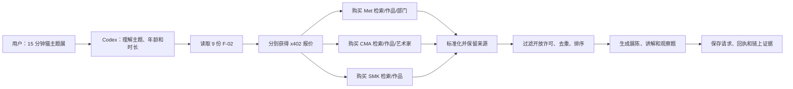

# 第二阶段 A 选题可行性报告

**项目：Cross-Museum MiniCurator（跨馆主题迷你策展助手）**  
**状态：选题与上游可行性验证完成，尚未进入 Cloudflare 部署和正式实现**  
**日期：2026 年 10 月 23 日**

## 一、结论

建议选择 mentor 候选 Idea ③“私人策展师”，将其实现为**跨馆主题迷你策展助手**。

演示场景：

> 给 10 岁孩子做一个 15 分钟的猫主题艺术展。请从不同馆藏中挑选适合公开展示的作品，给出展览顺序、简短讲解和观察题，并附图片与来源。

在阶段一基础上，Codex 不再只访问一个天气服务，而是先理解用户需求，再分别读取并购买 Met、Cleveland Museum of Art（CMA）和 SMK 的馆藏服务，最终整合成一个可以展示的展览方案。

推荐该方向的主要依据：

- 三个馆藏来源均可免费访问，不需要 API key。
- 相关元数据和公版图片的开放许可较明确，可以直接支持最终交付。
- 馆藏数据属于相对稳定的目录数据，适合缓存并通过全量数据或变更记录降低上游压力。
- 可以自然拆成 9 个独立收费资源，不需要为了增加数量而人为拆分接口。
- 最终结果包含图片、作品、作者、来源、讲解和展陈顺序，适合完整演示 Agent 的多服务采购与整合能力。

## 二、阶段 2A 的目标复述

阶段 2A 是在第一阶段单一天气服务的基础上做横向扩展：

```text
用户自然语言
→ Codex 阅读各服务的 F-02
→ 将任务拆成需要购买的数据
→ 核对各服务的 x402 报价
→ 分别采购 5–10 个 Cloudflare API
→ 整合数据并交付最终方案
→ 保存支付和交付证据
```

本阶段的交付重点仍是 **x402 Agent 交易与多服务编排**。x402 协议、签名和结算能力继续复用官方组件；项目侧负责服务封装、数据适配、缓存、接口文档、部署和验收。

与第一阶段相同，每个服务至少应包含：

- 可免费读取的 F-02；
- 免费健康检查；
- 未付款时返回 HTTP 402；
- 付款后返回结构化数据和支付回执；
- 可关联的请求编号和来源信息；
- 可独立核验的链上证据。

## 三、候选方向比较

下表用于说明当前选择，不代表其他方向无法实现。

| 候选 | 主要优点 | 当前阶段的主要阻力 | 评估 |
|---|---|---|---|
| ① 开源依赖体检员 | deps.dev、OSV 查询直接；漏洞和依赖链结果明确 | 大多数服务来自同一依赖数据生态；部分 GitHub 数据有未认证调用额度；项目更接近分析流水线 | 第一备选 |
| ② 论文阅读与复现侦察员 | arXiv、Crossref 元数据丰富 | 开放全文覆盖不完整；部分服务需要邮箱或额外配置；复现信息需要较多推断 | 可做，复现性较弱 |
| ③ 私人策展师 | 三馆交叉检索；数据和图片可直接交付；易于缓存 | 必须严格过滤开放许可；部分作品缺图片或作者信息 | **首选** |
| ④ 观星／摄影窗口 | 天气、日月和地点数据组合直观 | 云量和降雨实时变化；结果容易受当天现场条件影响 | 演示稳定性较弱 |
| ⑤ 食品条码比较 | 消费者场景直观 | 产品覆盖率不均；部分数据源有频率限制或需要凭据 | 不建议当前优先 |
| ⑥ 亲子自然寻宝 | 地点、物种和天气可形成体验 | 地理和时间相关性差异大，需要额外安全边界 | 第二备选 |
| ⑦ 资助机会侦察 | 政府来源公开，截止日期清楚 | 主要面向美国项目；交互与跨服务体验弱于策展 | 可做，不适合当前演示 |

## 四、拟部署的 9 个 x402 API

每次付费请求负责一个原子数据任务。Codex 必须采购多个服务，才能完成完整策展方案。

| 编号 | 服务 | 上游接口 | 付费后返回 |
|---|---|---|---|
| 1 | `met-search` | Met `v1.1/search` | 主题命中的作品 ID、总数和分页信息 |
| 2 | `met-artwork` | Met `/objects/{objectID}` | 标题、年代、作者或文化、媒介、图片、许可和馆藏链接 |
| 3 | `met-departments` | Met `/departments` | 馆内部门编号和名称 |
| 4 | `cma-artwork-search` | CMA `/artworks/` | 带图片的 CC0 作品候选 |
| 5 | `cma-artwork` | CMA `/artworks/{id}` | 完整作品档案、图片地址和许可状态 |
| 6 | `cma-artist-search` | CMA `/creators/` | 艺术家 ID、生平信息和关联作品 |
| 7 | `cma-artist` | CMA `/creators/{id}` | 艺术家详情和作品列表 |
| 8 | `smk-search` | SMK `/art/search/` | 第三馆作品、图片和公版状态 |
| 9 | `smk-artwork` | SMK `/art/` | 标题、作者、年代、材料、图片和权利链接 |

服务可以复用同一个 Worker 基础设施，但每个服务应有独立的 x402 资源、报价、F-02、缓存命名空间、测试和状态。最终采用独立 Worker 还是在同一仓库中部署 9 个服务，可在实操阶段根据部署成本确定；验收时每个资源都必须能独立购买和核验。

## 五、Agent 交易架构



核心设计：

1. Codex 先读取文档和报价，再决定购买哪些数据。
2. 检索结果与作品详情分开交付，避免搜索结果冒充完整作品档案。
3. 返回结果统一包含博物馆、对象 ID、标题、作者、年代、媒介、图片、权利、来源和抓取时间。
4. API 返回经过许可校验的图片 URL，不代理完整图片文件，避免把图片流量变成服务负担。
5. 上游失败时只返回带 `stale: true` 和原始抓取时间的最后一次有效缓存；无有效缓存则明确失败。
6. 继续沿用第一阶段规则：每次购买最多一次签名、一次付费提交；状态不明时先只读查账，不自动重买。

## 六、免费获取、许可和限额

| 来源 | 接入条件 | 数据与图片许可 | 限额与缓存 |
|---|---|---|---|
| Met Museum | 无需注册或 API key | 官方文档说明馆藏数据可用于商业和非商业用途，采用 CC0；可返回对应公版高清图片 | 官方建议不超过 80 请求/秒；查询和对象详情缓存 |
| Cleveland Museum of Art | 无需注册或 API key | 官方文档说明文档快照中的 64,000+ 作品记录可用；CC0 作品和图片可用于商业和非商业用途 | 未公布统一每秒请求上限；使用分页、短查询缓存和小并发 |
| SMK | 无需注册或 API key | 官方提供馆藏数据；`public_domain=true` 作品的配套图片可自由使用 | 未公布明确数值上限；提供夜间全量数据约 50 MB 和变更记录，可作为缓存与更新来源 |

官方文档：

- [Met Collection API](https://metmuseum.github.io/)
- [CMA Open Access API](https://openaccess-api.clevelandart.org/)
- [CMA Open Access Policy](https://www.clevelandart.org/open-access)
- [SMK API](https://www.smk.dk/en/article/smk-api/)

需要明确区分：**上游馆藏数据和公版图片免费，我们部署的检索、缓存、校验和策展服务仍通过 x402 收取 Base Sepolia 测试 USDC。** 收费对象是 API 和计算服务，不改变作品的 CC0/公版许可。

## 七、实际可行性验证

2026 年 10 月 23 日，对 9 个拟用上游接口各执行两轮只读直连检查，无自动重试：

| 检查项 | 结果 |
|---|---:|
| 有效 JSON 响应 | **18 / 18** |
| 9 个接口成功次数 | **每个接口 2 / 2** |
| HTTP 429 | **0** |
| 观测响应时间 | 约 0.16–4.08 秒 |
| 作品、艺术家和搜索结果引用一致性 | **9 / 9** |
| 三家馆示例图片部分读取 | **3 / 3** |

图片检查确认了 HTTP 状态、图片 MIME、JPEG 签名和实际字节读取。Met、CMA、SMK 的示例作品都同时具备作品档案、开放权利标记和可读取图片。

仓库证据：

- [9 接口连通性原始记录](../evidence/phase2a/connectivity-final-nine-direct.json)
- [跨资源和图片核验](../evidence/phase2a/curator-crosslink-and-image-proof.json)
- [官方文档来源与哈希](../evidence/phase2a/official-source-manifest.json)

探测还发现 Met 旧版 `v1/search` 已于 2026-10-01 退役并返回 410；方案已改用官方 `v1.1/search`。

当前本机代理链路在较早的并发探测中曾出现间歇性 TLS reset，随后独立直连复测全部成功。因此，当前证据支持“馆藏上游可访问且适合作为阶段 2A 选题”，但**还不能据此声称 Cloudflare 出站已经验证**。

## 八、风险与控制措施

1. **版权过滤**
   - 只接受 `public_domain=true`、`isPublicDomain=true` 或 `share_license_status="CC0"` 的记录。
   - 权利状态缺失时，不将该作品放入可公开展示的最终方案。

2. **博物馆商标和背书**
   - 不使用馆徽或官方身份表达。
   - 保留作品出处、馆名和原始链接，但明确本项目是独立 Agent 服务。

3. **调用限额**
   - Met 严守 80 请求/秒。
   - CMA 和 SMK 采用低频访问、缓存和全量数据后备，不进行无界遍历。
   - 不把“官方未公布数值限额”理解为无限调用。

4. **数据失败**
   - 不补造标题、年代、作者或图片。
   - 缓存只用于明确标记的降级返回。
   - 每次响应都保存上游来源和抓取时间。

5. **支付与交付不一致**
   - 已付款但数据交付失败时标记 `paid_delivery_failed`。
   - 状态不明时先只读查账，禁止自动重复购买。

## 九、实操阶段的第一道验收门槛

选题确认后，建议先不建设完整策展产品，而是在 Cloudflare 部署一个最小出站探测 Worker，对上述 9 个上游 URL 执行同条件检查。

通过标准：

- 9 个接口均返回可解析的成功响应；
- 记录 Cloudflare 侧状态码、耗时和错误；
- 验证返回字段与本次本机样本一致；
- 对上游应用礼貌缓存和并发控制；
- 通过后再开始正式服务、F-02、支付和证据链实现。

## 十、本轮完成边界

本轮已完成：

- Mentor 候选方向整理与比较；
- 选择“跨馆主题迷你策展助手”；
- 确定 3 个免费馆藏来源和 9 个 x402 API；
- 核对官方许可、接入条件和限额；
- 完成接口、引用关系和图片的只读连通性验证；
- 保存可复核证据。

本轮未执行：

- 未部署第二阶段 Worker；
- 未实现策展服务；
- 未购买新的 x402 API；
- 未修改第一阶段天气服务。

请 mentor 审阅选题和 API 粒度。确认后，下一步进入 Cloudflare 出站连通性门槛和正式实现。