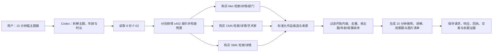

# 第二阶段 A 选题可行性报告

日期：2026 年 10 月 23 日  
状态：**选题与上游可行性验证完成；尚未部署第二阶段服务，也未发起新的 x402 支付。**

## 1. 对阶段 2A 目标的理解

第二阶段 A 是在第一阶段已验证的 x402 单服务模式上做**横向扩展**：

1. 先确定一个项目。项目要能自然拆成 5–10 个相互补充、可由 Agent 分别采购的数据服务。
2. 在 Cloudflare 上部署这些服务，每个服务都保留第一阶段的结构：可读的接口文档、免费健康检查、收费资源、实际数据、支付回执与可核验证据。
3. 用户只给自然语言目标。Codex 先理解任务、读取各服务的接口文档，再按需要分别购买数据、整合结果并交付一个完整方案。
4. 本阶段的核心仍是 **x402 Agent 交易与多服务编排**。我们的工作包括服务封装、数据适配、缓存、接口文档、部署和验收；x402 协议与结算能力继续复用官方组件。
5. 本轮只做选题和可行性证明。确认后停止，待用户查阅并同意，再进入部署与代码实现。

可验收的目标流程应是：

```text
用户自然语言
→ Codex 读取 F-02
→ 拆分所需数据并核对 402 报价
→ 分别调用并购买 5–10 个自有 x402 API
→ 获取馆藏、作品、艺术家和图片权利信息
→ Codex 筛选、排序并生成完整展览方案
→ 保存每次交付、支付回执与链上核验证据
```

## 2. 选题结论

**建议选择 mentor 候选 Idea ③，并将范围明确为“跨馆主题迷你策展助手”。**

示例请求：

> 给 10 岁孩子做一个 15 分钟的猫主题艺术展。请从不同馆藏挑选适合公开展示的作品，给出展览顺序、简短讲解和观察题，并附来源与图片。

暂定项目名：**Cross-Museum MiniCurator（跨馆主题迷你策展助手）**。

它胜出的原因不是主题更花哨，而是适合阶段 2A 的工程验收：

- **上游免费且无需账户或 API key**：Met、Cleveland Museum of Art（CMA）和丹麦 SMK 都提供公开馆藏接口。
- **数据和图片许可清楚**：Met 与 CMA 的相关数据采用 CC0；SMK 对 `public_domain=true` 的作品标明图片数据可自由使用。
- **数据来源较稳定、适合缓存**：馆藏检索、对象详情和艺术家资料属于相对稳定的目录数据，不像天气、交通或库存数据那样必须持续实时刷新。
- **9 个 API 有真实需求**：主题检索、作品详情、部门上下文、跨馆艺术家检索与详情、第三方馆藏搜索和对象详情能组成完整策展流程。
- **演示结果完整**：最终交付同时包含作品、图片、来源、展陈顺序、讲解和观察题，不只是返回一条 JSON。
- **容易保留 x402 的交易语义**：每一次检索或详情获取都可独立报价、独立交付、独立审计；Codex 必须实际采购多个资源才能完成最终方案。
- **安全边界清楚**：只选 `public_domain=true`、`isPublicDomain=true` 或 `share_license_status="CC0"` 的记录，并保留作品来源。作品开放不授予博物馆商标或背书权。
- **验证覆盖更完整**：9 个馆藏上游接口各检查两轮，18/18 成功，并另行核对三馆作品的跨资源引用与图片字节。依赖体检备选也完成了 deps.dev/OSV 的 8/8 探测，但它的服务主要围绕同一依赖聚合器和漏洞库展开；策展方案有三个独立馆藏来源，更适合检验 Agent 的横向采购与整合。

## 3. Mentor 候选 Idea 的比较

下表用于确定“当前最适合 2A”的方向；“不推荐”只表示不适合本阶段作为首要项目，不表示技术上不可做。

| 候选 | 优点 | 主要阻力 | 判断 |
|---|---|---|---|
| ① 开源依赖体检员 | 有明确工程场景；可输出升级优先级；[deps.dev/OSV 的 8 个读取端点本轮 8/8 成功](../evidence/phase2a/dependency-sentinel-upstream-probe-2026-10-23.json) | 9 个服务主要基于同一依赖聚合器与 OSV；独立来源数量少于策展方案；GitHub 未认证接口额度低，因此不能作为必需链路 | 可行，列为第一备选 |
| ② 论文阅读与复现侦察员 | 学术价值高；arXiv、Crossref 数据充足 | 开放全文并非每篇都有；部分服务要求联系邮箱或额外 API 配置；复现代码识别需要更多启发式判断 | 适合研究型演示，当前可复现性弱于馆藏 |
| ③ 私人策展师 | 元数据与图片均可用；三馆可交叉检索；步骤能拆成 9 个收费原子 | 需要严格过滤版权状态；部分馆藏缺图片、作者或详细说明 | **首选** |
| ④ 观星／摄影窗口推荐 | 天气、日月和地点信息组合直观 | 云量、降雨和可见性会实时变化；部分天气 API 有非商业或调用频率条件；结果天然易受当天天气影响 | 可做，但现场验收不稳定 |
| ⑤ 食品条码比较助手 | 可与消费者场景结合 | 条码覆盖率不一；Open Food Facts 有搜索频率限制；USDA 接口需要单独凭据；品牌与营养缺失会破坏纵向流程 | 不建议当前优先 |
| ⑥ 亲子自然寻宝向导 | 空间与物种数据结合有体验感 | iNaturalist、GBIF 和天气的地理/时间条件各不相同；生成任务需要额外安全边界；不同地点结果差异很大 | 可行，列为第二备选 |
| ⑦ 科研／公益资助机会侦察 | 政府来源公开，有明确截止日期 | 主要面向美国项目；查询量与数据结构偏政务；交互展示和跨服务体验弱于策展 | 可做，但不适合当前横向服务演示 |

## 4. 拟部署的 9 个 x402 API

每次付费请求只负责一个明确的数据原子；搜索结果不冒充完整作品详情，详情接口也不偷偷替代跨馆编排。

| # | 自有服务 | 上游接口 | 付费后返回 | 在策展中的作用 |
|---|---|---|---|---|
| 1 | `met-search` | Met Collection API `v1.1/search` | 主题命中的对象 ID、总数、分页信息 | 初选 Met 作品 |
| 2 | `met-artwork` | Met `/objects/{objectID}` | 标题、年代、作者/文化、媒介、图片、许可、馆藏链接和部门 | 核验并丰富单件作品 |
| 3 | `met-departments` | Met `/departments` | 馆内部门 ID 与名称 | 为作品补充机构内类别 |
| 4 | `cma-artwork-search` | CMA `/artworks/`，强制 `cc0=1&has_image=1` | 可公开使用且带图片的作品候选 | 初选 CMA 作品 |
| 5 | `cma-artwork` | CMA `/artworks/{id}` | 完整作品档案、图片尺寸、许可与来源 | 核验单件作品 |
| 6 | `cma-artist-search` | CMA `/creators/?name=...` | 艺术家 ID、生平简要和关联作品 | 找候选艺术家 |
| 7 | `cma-artist` | CMA `/creators/{id}` | 艺术家详情与关联作品列表 | 补足作者上下文和同主题作品 |
| 8 | `smk-search` | SMK `/art/search/` | 馆藏对象、图片与 `public_domain` 标记 | 引入第三个馆藏来源 |
| 9 | `smk-artwork` | SMK `/art/?object_number=...` | 标题、作者、材料、年代、IIIF/图片和权利链接 | 核验并交付单件作品 |

每个服务部署时可复用同一套 Worker 基础设施，但应具有独立的 x402 资源、报价、F-02、缓存命名空间、测试和状态。是否做成 9 个独立 Worker，或以一个仓库内 9 个独立 Worker 部署，留到实操阶段按部署与验收成本确定；验收标准不以“同域路由”代替“独立可购买服务”。

## 5. 完整 Agent 交易架构



关键设计：

- **先理解、后购买**：Codex 先阅读接口文档并核对报价，不根据记忆猜参数或价格。
- **按原子数据采购**：检索、作品详情和艺术家详情分别交付，支持按需购买，也让交易和服务一一对应。
- **统一但保源的返回结构**：标准化 `museum / id / title / creator / date / medium / image / rights / source / retrievedAt`，同时保留原始馆方链接。
- **图片不进入收费代理链路**：API 返回经过权利校验的图片 URL；客户端直接读取图片。这样不把大图片流量变成 Worker 或上游 API 的负担。
- **缓存和降级**：缓存查询与对象详情；上游失败时只能返回带 `stale: true`、原抓取时间的最后一次成功数据。无缓存时就明确失败，不能伪造“最新”内容。
- **付款安全沿用阶段一**：每次购买只签一次、只提交一次；状态不明时先只读查账；不自动重复付款。

## 6. 免费、许可和限额证据

| 来源 | 接入成本 | 许可/使用依据 | 已核对的限额信息 | 缓存策略 |
|---|---|---|---|---|
| Met Museum | 无需注册、无需 API key | 官方 API 文档说明：超过 47 万件作品的数据可供商业和非商业使用，采用 CC0；API 可返回对应的公版高清图片 | 官方建议不超过 **80 请求/秒** | 查询和对象结果缓存；严守 80/s，演示采用远低于该值的串行/小并发 |
| Cleveland Museum of Art | 公开 REST 接口，无需 API key | 官方 API 文档说明：文档快照中的 64,000+ 作品记录可用；CC0 作品和图片可用于商业与非商业用途 | 官方文档未给统一的每秒请求上限；本次未收到 429 | 结果分页、短查询缓存，避免并发扫库 |
| SMK | 公开 REST 接口，无需 API key | 官方 API 页面允许访问并使用馆藏数据；`public_domain=true` 作品的配套图片可自由使用；接口同时提供更新记录和约 50 MB 的夜间全量数据 ZIP | 官方 API 页面未公布明确数值上限；全量 ZIP 与变更日志提供避峰缓存路径 | 对象缓存；搜索高峰使用馆方全量数据/变更记录做后备，不连续轰击搜索接口 |

官方来源：

- [Met Collection API](https://metmuseum.github.io/)
- [Cleveland Museum of Art Open Access API](https://openaccess-api.clevelandart.org/)
- [Cleveland Open Access policy](https://www.clevelandart.org/open-access)
- [SMK API](https://www.smk.dk/en/article/smk-api/)

官方文档抓取时间、字节数与 SHA256 记录在 [source manifest](../evidence/phase2a/official-source-manifest.json)。

这里需要区分两件事：**上游馆藏数据免费**，而我们的封装、检索、缓存、校验和策展编排服务仍按 x402 收取 Base Sepolia 测试 USDC。收费对象是 API/计算服务，不改变馆藏作品的 CC0/公版许可。

## 7. 实际连通性与完整性检查

2026-10-23 使用当前 Windows 主机直连路径、无自动重试，对 9 个拟用上游接口各检查两轮：

| 检查结果 | 数值 |
|---|---:|
| 有效 JSON 响应 | **18 / 18** |
| HTTP 429 | **0** |
| 单接口成功次数 | 全部 2 / 2 |
| 单次观测耗时 | 约 0.16–4.08 秒 |
| 三家馆示例图片部分读取 | **3 / 3 通过**（JPEG 签名、图片类型、字节读取均通过） |
| 对象、创作者、搜索结果之间的引用一致性 | **9 / 9 断言通过** |

原始网络记录见 [connectivity-final-nine-direct.json](../evidence/phase2a/connectivity-final-nine-direct.json)，作品、艺术家和图片的交叉核验见 [curator-crosslink-and-image-proof.json](../evidence/phase2a/curator-crosslink-and-image-proof.json)。

探测还发现 Met 旧版 `v1/search` 已于 2026-10-01 退役并返回 410，官方替代为 `v1.1/search`。方案已采用新版本，因此这一变化不会阻断项目。

当前本机代理链路在较早的并发探测中出现过间歇性 TLS reset，但独立直连复测全部通过。这个差异说明较早失败发生在本机链路，不足以推断三家馆 API 存在持续性上游故障。**正式实现时仍需在 Cloudflare Worker 部署环境中重做同样的 9 接口出站检查**；在云端通过之前，不把本机结果升级为“Cloudflare 已证明连通”。

## 8. 必须先守住的风险边界

1. **版权过滤不能靠模型猜测**：只接受明确的公版/CC0 标记；缺失时拒绝作为可展示作品。
2. **博物馆开放不等于商标授权**：不以馆徽、品牌字体或官方口吻暗示 endorsement；作品署名和来源仍明确保留。
3. **API 无公开数值限额不等于无限调用**：Met 严格遵守 80/s；CMA/SMK 使用低频、缓存和批量数据后备，不进行无界全站遍历。
4. **网络失败不能变成虚假成功**：只返回带抓取时间和来源的缓存；无有效数据就失败，不补造标题、年代、作者或图片。
5. **x402 支付结果必须与交付对应**：付款成功但数据失败时标记 `paid_delivery_failed`，先查账再决定能否重新购买。
6. **多服务不承诺生产级 SLA**：本阶段验证的是 Agent 可分别采购多个数据服务并完成整合，不承诺成为生产级博物馆平台。

## 9. 本轮完成边界与实操入口

本轮已经完成：

- 复述阶段 2A 的目标与架构边界；
- 比较 mentor 提出的 7 个方向；
- 选出“跨馆主题迷你策展助手”；
- 枚举 3 个免费馆藏来源对应的 9 个 API；
- 实际验证 JSON 数据、跨资源引用和三件示例图片；
- 核对官方免费/许可说明并保存可复核证据。

本轮**没有**创建第二阶段 Worker、没有部署新服务、没有购买新的 API，也没有改写第一阶段天气服务。

用户确认选题后，下一轮的第一道实操门槛应是：用临时 Cloudflare Worker 对 9 个上游接口做同条件出站检查；通过后，再开始正式实现服务、F-02、缓存和 x402 验收。
