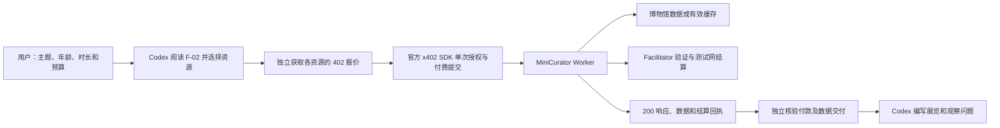

# x402 Agent 数据采购项目阶段进展报告

**汇报日期：2026 年 10 月 25 日**  
**当前方向：Cross-Museum MiniCurator（跨馆主题迷你策展助手）**  
**运行环境：Cloudflare Workers；Base Sepolia 测试网；测试 USDC**

## 1. 项目结论

第一阶段已实现“用户提出天气需求 → Codex 阅读接口文档 → 通过 x402 支付 → 获取天气数据 → 独立核验付款和交付”的完整流程。第二阶段在此基础上，扩展到三个博物馆、九个可以分别购买的数据资源，并由 Codex 将采购结果整合成一个主题展览。

**当前状态：第二阶段 A 的测试网配置和九项独立采购已完成，九个资源均达到 `verified`，总支付 0.009 测试 USDC，没有未解决的付款结果。** 逐笔结果与九项跨资源关联检查见[演示会话](../evidence/phase2a/demo-session.json)。本结论针对测试网功能与演示，生产使用前仍有第 7 节列出的待解决事项。

## 2. 第一阶段实现了什么

第一阶段搭建了团队自己的天气 API 服务，接入 MET Norway 数据，运行在 Cloudflare Workers。自然语言需求由 Codex 理解，再转换成文档规定的坐标参数；天气 API 本身执行确定的查询、数据校验和支付流程。

| 能力 | 已实现的行为 |
|---|---|
| 文档驱动调用 | Codex 读取在线 F-02，保留文档内容、读取时间和 SHA256 |
| 标准支付交互 | 未付款返回 HTTP 402 和 x402 报价；买方通过官方 SDK 授权后提交付费请求 |
| 天气数据交付 | 返回天气字段、位置、模型时间、来源和许可；无效或陈旧数据在结算前拒绝 |
| 测试网真实结算 | 使用 Base Sepolia 测试 USDC，每次成功调用 0.001 |
| 独立付款核验 | 核对结算回执、链上成功状态、精确 Transfer、双方余额及交付内容 |
| 异常处理 | 一次购买最多签名一次、提交一次付费请求；结果不明时先查账 |
| 验收证据 | 2026-10-22 复核包含 65 项自动化测试、30 项接口边界检查和真实云端交易 |

2026-10-22 的复核交易为 `0x7858f5bc9d2d3c22f9709c200f84b86f1dd2927242d126fce90bc00bf4856ff1`，当次买方余额 19.998 → 19.997、卖方 0.002 → 0.003，支付和天气交付均为 `verified`。这些是历史验收结果；天气内容是模型预报，不是气象站实时观测。

第一阶段详细材料：[完整复核报告](第一阶段_复核报告_2026-10-22.md)、[交易原始记录](../evidence/transactions/purchase-1792639327312.json)、[两个 RPC 的交叉核验](../evidence/transactions/transaction-rpc-crosscheck-summary-2026-10-22.json)。

## 3. 第二阶段扩展了什么

MiniCurator 的示例需求是：**为一名 10 岁孩子制作一个 15 分钟的“猫”主题艺术展，涵盖三个博物馆，提供作品、图片、展览顺序、中文讲解、观察问题与来源。**

数据来自美国大都会艺术博物馆（Met）、克利夫兰艺术博物馆（CMA）和丹麦国家美术馆（SMK）。上游开放数据免费；本项目对检索、标准化、权利校验、缓存与交付服务收取测试网费用，保留原作品许可和来源。

本轮采用一个独立的 MiniCurator Worker 承载九个资源。每个资源都有独立的 API 路径、F-02、健康接口、报价、缓存命名空间和对应测试，可以单独购买。

| 来源 | 资源 | 交付内容 | 验收采购状态 |
|---|---|---|---|
| Met | `met-search` | 主题命中的作品 ID 和分页信息 | [verified](../evidence/phase2a/purchases/met-search-1792904993023.json) |
| Met | `met-artwork` | 公版作品详情、图片和来源 | [verified](../evidence/phase2a/purchases/met-artwork-1792905093025.json) |
| Met | `met-departments` | 部门编号和名称 | [verified](../evidence/phase2a/purchases/met-departments-1792906417078.json) |
| CMA | `cma-artwork-search` | 带图片且符合 CC0 条件的候选作品 | [verified](../evidence/phase2a/purchases/cma-artwork-search-1792906533294.json) |
| CMA | `cma-artwork` | 作品详情、作者引用、图片与许可 | [verified](../evidence/phase2a/purchases/cma-artwork-1792906617520.json) |
| CMA | `cma-artist-search` | 艺术家和关联作品引用 | [verified](../evidence/phase2a/purchases/cma-artist-search-1792906685098.json) |
| CMA | `cma-artist` | 艺术家档案与关联作品列表 | [verified](../evidence/phase2a/purchases/cma-artist-1792907255236.json) |
| SMK | `smk-search` | 公版候选作品及图片信息 | [verified](../evidence/phase2a/purchases/smk-search-1792908028710.json) |
| SMK | `smk-artwork` | 公版作品详情、图片和来源 | [verified](../evidence/phase2a/purchases/smk-artwork-1792908060324.json) |

九个资源各买一次的验收预算为 **0.009 测试 USDC**。这用于证明每项资源能独立交易；日常策展由 Codex 按需求选择资源，额外调用仍会另行收费。

## 4. Agent 如何完成任务

**Codex 负责理解需求、采购决策、选件、排序和中文表达；API 负责固定规则、数据与权利校验、缓存和支付。** Worker 内部不调用大模型，也不需要模型 API key。

执行顺序为先验证支付授权，再准备并校验数据，随后结算和交付。该顺序减少无效数据被收费的风险；网络响应丢失仍需对账。搜索 ID 和艺术家关联作品不自动具备图片使用证明，最终展示依赖作品详情中的明确公版标记。

## 5. 本轮验收证据

| 检查 | 结果 | 证据 |
|---|---|---|
| Cloudflare 出站访问 | 九个上游各两份有效响应，18/18 | [出站记录](../evidence/phase2a/cloudflare-egress-2026-10-25.json) |
| 正式部署 | MiniCurator 版本 `c2a576fc-6a36-4bb7-bf07-c47cde342f21` 承担 100% 流量 | [部署核对](../evidence/phase2a/deployment-2026-10-25.json) |
| 文档、健康、报价 | 九份 F-02、九个健康接口、九个未付款报价均通过 | [免费探测](../evidence/phase2a/probe-1792907137985.json) |
| 云端边界 | 超长付款头 431、非法 CMA ID 400、SMK 外部 URL 400，3/3 | [实测记录](../evidence/phase2a/live-boundaries-2026-10-25.json) |
| 逐资源真实采购 | 9/9；付款和数据交付均通过，九项跨资源断言通过 | [会话与逐笔索引](../evidence/phase2a/demo-session.json) |
| 作品图片 | 对三份付费作品详情返回的原图 URL 检查状态、MIME、实际字节和 JPEG 签名 | [图片实测](../evidence/phase2a/image-proof-2026-10-25.json) |
| 业务与构建 | 完整 verify：150 项测试、两个 Worker 构建、文档与凭据检查均通过 | [最终检查摘要](../evidence/phase2a/final-verification-2026-10-25.json) |
| 第一阶段保护 | 天气 Worker 仍为 `15b034a3-a6bc-4850-befe-1d2f66fbae88`，100% 流量 | [同次部署核对](../evidence/phase2a/deployment-2026-10-25.json) |
| 临时设施清理 | 本次出站探测 Worker 已删除；正式策展和天气部署再次核对 | [清理证据](../evidence/phase2a/temporary-worker-cleanup-2026-10-25.json) |
| GitHub 发布前复核 | 2026-10-28 再次通过 150 项测试、构建、文档/凭据扫描；线上 9/9、双 RPC 9/9，没有新增付款 | [发布前复核](../evidence/phase2a/release-verification-2026-10-28.json) |

公开采购记录保留实际读取的 F-02、402 报价、公开授权字段、200 响应、请求编号、结算回执、精确转账和余额核验。私钥、部署 Token 与完整可重放的支付签名不进入公开证据。

## 6. 演示产出与成本

已从付费返回结果选取三件作品，形成[15 分钟猫主题迷你展览](第二阶段A_猫主题迷你展览.md)：

| 顺序 | 馆藏与作品 | 付费详情中的年代和媒介 | 图片权利 |
|---|---|---|---|
| 1 | Met，552027，*Cat* | 公元前 664—30 年；Cupreous metal（铜质金属） | CC0；`isPublicDomain=true` |
| 2 | CMA，152829，*Cat and Butterfly*；Min Zhen | 1788 年；册页，纸本水墨 | CC0 |
| 3 | SMK，KMS3402，*The Cat in the Studio*；David Jacobsen | 1860 年；布面油画 | Public Domain Mark |

展览包含 1 分钟导入、每件 4 分钟观察和讲解、2 分钟比较，总计 15 分钟。事实标签来自已购数据；中文说明、问题和展陈顺序由 Codex 编写。

九笔成功采购合计 **9000 个原子单位，即 0.009 测试 USDC**，达到预设预算，随后停止采购。本轮发生过三次签名后响应丢失，均在授权过期后核实未使用、余额未变、无相关转账，状态为 `not_charged_reconciled`；另有四次在签名前中止的失败。它们不计入成功次数，也未增加确认支出。全部 16 份尝试记录均保留，没有未解决的签名付款结果。

示例链上交易：SMK 作品详情 `0x20308fdc292cba38f120ea0fd01434d0a1e65901ab7b204ecf67a4b61ebe3d3c`。原始采购记录可核对该交易的成功回执、1000 单位 Transfer 和双方余额变化。

[在 Base Sepolia 浏览器核对这笔交易](https://sepolia.basescan.org/tx/0x20308fdc292cba38f120ea0fd01434d0a1e65901ab7b204ecf67a4b61ebe3d3c)。

验收后发现并修复了取证审计缺口：旧审计只核对 Transfer 和余额，证据中的授权 nonce 即使被篡改也仍可能显示 `verified`。修复后的审计会把 nonce、授权付款人、收款人、金额、有效时间与链上 `AuthorizationUsed` 事件绑定，并同时检查结算 payer、声明网络/资产、请求编号、资料正文和双方余额。九笔历史交易已在不重新付款的情况下，由 Tenderly 与 Pocket 两个不同 RPC 全部复验通过，没有失败项；见[独立链上重审](../evidence/phase2a/independent-chain-reaudit-2026-10-25.json)。上游 JSON 读取也增加了 2 MiB 流式上限，超限内容不会解析或缓存。

## 7. 已知限制与下一步

1. **测试网功能验收。** 本轮有限时点的成功不构成生产可用性或 SLA；博物馆上游、facilitator、RPC 和本机网络均可能影响演示。
2. **依赖风险尚未清零。** 当前 npm 审计报告 6 个 high 条目，来自同一个 Zod 公告及其 x402 依赖链。已部署付款头、URL 和报价头长度限制，但尚未消除上游漏洞；生产使用前需要兼容修复、重审与重新部署，见[依赖审计说明](第二阶段A_依赖审计说明.md)。
3. **馆藏事实保留不确定性。** 作者缺失时标为未知；CMA 艺术家字段存在“1788”与“1788 年之后”的冲突，不据此断言卒年。中文讲解和观察题为 Codex 编写，不冒充博物馆原文。
4. **图片通过原馆地址展示。** API 交付图片 URL 与许可，不代理图片二进制；离线阅览和长期保存需要另行设计。
5. **范围仍为文档驱动采购。** 自主议价、多买卖方市场、复杂多 Agent 协作与主网收费尚未验证。
6. **总预算由调用方累计。** `curator:buy` 是单笔工具，只锁定每笔 1000 原子单位；0.009 的会话预算依赖 Agent 按已确认回执累计并停止，尚无共享的会话级账本。
7. **丢失响应没有自动补交。** 成功的 exact 付款可由授权事件和链上回执证明，未知状态也会被对账阻断；若付费响应丢失，当前流程不会通过重放签名自动重取同一数据，避免引入双重结算或签名泄漏风险。

后续可另设验收目标：更换主题后的泛化测试、按需采购成本比较，以及兼容依赖修复后的生产准备。现有证据可供 mentor 直接审阅，无需为查看历史结果重复付款。

## 8. 审阅入口

- [MiniCurator 使用说明](第二阶段A_使用说明.md)：给 Codex 的需求模板、免费检查和购买/查账命令。
- [猫主题迷你展览](第二阶段A_猫主题迷你展览.md)：可直接阅读的本轮交付示例。
- [演示会话与采购索引](../evidence/phase2a/demo-session.json)：预算、各资源状态和逐笔证据。
- [阶段二证据目录](../evidence/phase2a/README.md)：部署、出站、探测、依赖审计和历史选题记录。
- [第一阶段完整复核](第一阶段_复核报告_2026-10-22.md)：天气服务的历史验证。

在线服务：<https://yoyo-x402-minicurator.accessible-trip.workers.dev>  
总接口文档：<https://yoyo-x402-minicurator.accessible-trip.workers.dev/F-02.md>
