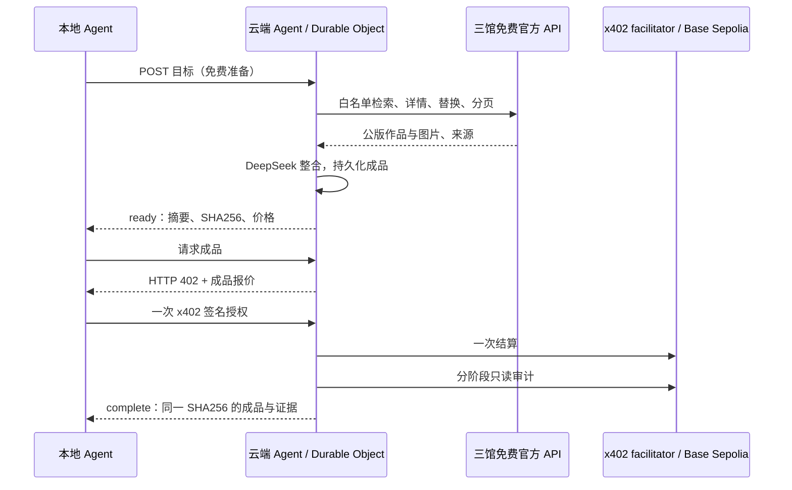

# 第二阶段 B：Mentor 反馈修订报告

日期：2026-11-03（北京时间）。范围：阶段 2-B 新任务的协议、执行、恢复和验收；阶段 1 与阶段 2-A 的线上版本及各自仓库保持原样。

本轮已完成测试网实现、部署和真实验证。当前流程是：本地 Agent 提交目标，云端 Agent 直接请求三馆免费官方 API，完成整合后，本地通过 x402 支付 0.003 测试 USDC 取得成品。四个主题共五个任务已交付，211 项自动化测试、10 项双 RPC 独立审计和 5 次重复取件检查通过。当前运行方式见[使用说明](第二阶段B_使用说明.md)，接口见 [F-02](F-02_cloud-curator.md)，机器证据见[修订检查摘要](../evidence/phase2b/review-2026-11-03/final-verification.json)。

## 1. 按反馈调整架构

旧协议把阶段 2-A 的收费接口当作云端上游，还预收采购预算，增加了付款、RPC 和故障恢复环节。根据此次沟通，新任务取消这一层：官方博物馆 API 本来免费，云端直接取数；x402 用于本地购买云端完成的服务。

费用固定为 `3000` 原子单位，即 `0.003` Base Sepolia 测试 USDC；上游付款为 `0`，不再预收采购预算。成品在付款之前完整保存，接口只返回摘要和哈希；链上付款审计通过才返回正文。报价描述和接受响应都绑定任务 ID 与成品哈希；x402 授权本身不在链上编码展览正文或 URL。

## 2. 问题、修正与证据

| 反馈问题 | 修正 | 验证 |
|---|---|---|
| 采购和查账挤在一次执行，触发过多 subrequests | 按规划、免费取数、报告生成、结算、查账分开 alarm；每步持久化。每次执行的实际 RPC HTTP 请求最多 12 次，包含节点切换，不使用隐藏轮询 | 请求上限、缓存续跑与分离结算/查账回归测试；四个真实任务交付 |
| `Block at number "53655608" could not be found` 等临时 RPC 故障直接终止 | 自动换节点、指数退避；最多六次连续临时失败，成功读取缓存后在下一 alarm 续跑。未知结算仅查精确 nonce，不再次提交授权 | 注入该错误的恢复测试；RPC 上限含失败重试测试；结算响应丢失、重启、未过期 nonce 和 150 区块分段扫描测试 |
| Met `497126`、`728109`、`761208` 等明确 422 仍被当作付款问题 | 权利不符、无图或 404/422 记为 `unavailable`，排除该详情 ID 并选下一个候选；免费上游不产生待查付款 | 不可用作品替换测试；真实猫任务跳过 `91120`，鸟类跳过 `693134`、`693135`、`693136` 后完成 |
| SMK 过滤后 `returned=0` 但仍有后页，模型又提前结束 | 根据原始 `total` 与 offset 继续翻页；已有候选优先读取未尝试的详情。程序要求 Met、CMA、SMK 都有有效详情，拒绝提前 finish，达到调用上限则免费失败 | `total=583, returned=0, excluded=5` 原样回归；提前结束回归；风景任务实际多页继续后取得 SMK 详情 |
| 本轮实测补充：合法 SMK 缩略图域名未被接受，单条坏记录拖垮整页 | 接受 `api.smk.dk/api/v1/thumbnail/…` 的受限路径；搜索逐条排除无效记录，加入公版服务端筛选，同时保留本地权利和图片检查 | 新回归测试；鸟类成品使用该官方缩略图；[实时鸟类/风景搜索验证](../evidence/phase2b/review-2026-11-03/smk-live-normalization.json)分别保留 9/3 条有效结果 |
| 最终检查补充：授权接受后，付款前余额 RPC 仍可能中断；过早 `reconcile` 会绕过首次结算 | 接受授权后先持久化为 `preparing_payment`，余额读取移到独立 alarm；按是否已提交结算选择正确的恢复阶段 | 两条新增回归在补丁前均失败，补丁后通过；覆盖余额 RPC 故障与对象重启、首次结算前两次 `reconcile`，结算次数始终为一 |

临时 RPC 故障及崩溃路径通过可控故障注入测试验证。本轮真实付款未强行制造链上故障；双 RPC 结果证明实际交易成功，不能代替故障注入的覆盖范围。

## 3. 四主题真实验收

所有场景均要求：为十岁孩子提供 15 分钟中文展览，三馆各有公版、有图片的作品，包含观察问题与可核查来源。生成前后使用同一任务，付款前确认正文不可见；付款后核对哈希不变。

| 主题 | 免费工具调用数 | 展览作品 ID（Met / CMA / SMK） | 独立审计 | 重复取件 |
|---|---:|---|---|---|
| [猫](examples/phase2b-v2-cats.md) | 7 | `552027` / `98363` / `KMS3402` | 2/2 | 通过 |
| [鸟类](examples/phase2b-v2-birds.md) | 9 | `12536` / `125886` / `KMSst352` | 2/2 | 通过 |
| [风景](examples/phase2b-v2-landscape.md) | 6 | `340468` / `139454` / `KMS8575` | 2/2 | 通过 |
| [花卉](examples/phase2b-v2-flowers.md) | 9 | `436293` / `314466` / `KKS2013-44` | 2/2 | 通过 |

表中四笔本地到云端付款各 `3000`，合计 `12000` 原子单位，即 `0.012` 测试 USDC。此外保留一份较早完成的风景验证任务，付款 `3000`；整轮实际五笔付款共 `15000`，即 `0.015` 测试 USDC。云端到上游付款笔数和金额均为 `0`。Tenderly、Pocket 两家 RPC 各自重审每笔交易，确认 receipt、精确 Transfer、`AuthorizationUsed(authorizer, nonce)`、授权双方地址/金额/有效期、网络与余额变化，共 10/10 通过。审计与重复取件不新增付款。各任务 ID、交易、成品哈希及证据路径见[场景矩阵](../evidence/phase2b/review-2026-11-03/scenarios.json)与[证据索引](../evidence/phase2b/README.md)。

本轮实际创建六个免费准备任务：五个成功，鸟类首轮在 24 次调用后以 `Report must include Met, CMA and SMK` 失败，未付款；修正 SMK 缩略图和逐条过滤后重建鸟类任务并成功。失败的[原始任务快照](../evidence/phase2b/job-13cadba9348e3df3a63a509aa80da32ffcc5606d4262ed08175f2b5c4e00909f.json)保留在仓库，未改写为成功。

猫、花卉和较早的风景任务生成于 SMK 缩略图补丁之前；它们的来源账本保留当时的拒绝记录，较早风景以 19 项调用和额外分页恢复成功。鸟类使用缩略图补丁生成；随后修复付款前余额准备边界，再从头运行表中的风景任务，六项调用均成功，并完整验证最终部署的准备、付款与取件流程。补丁前后的风景任务分别保存，未重写交易和来源记录；实时 `bird`、`landscape` 搜索也验证了筛选和缩略图修正。

## 4. 持久化、并行和付款恢复

目标、工具队列、每次尝试、标准化 JSON、模型调用证据、成品和审计读取均保存在 SQLite Durable Objects，不依赖云端临时目录。记录按小块原子保存并校验 SHA256，每条最多 2 MiB；任务保留七天。图片继续引用馆方 HTTPS URL，不复制成云端临时二进制文件。

最多三项免费请求并行；每项 GET 包括重启后的尝试累计不超过三次。默认 24 个不同工具调用，可设 6..30；最多十轮规划、十四次模型请求，模型输入和输出各受 128 KiB 限制。模型只能选择白名单服务和参数，不能自定上游域名或接触钱包/模型密钥。

结算前先保存授权已提交的标记。若响应丢失或执行中断，自动恢复时仅查询该 nonce 的使用状态与事件；每轮最多扫描 150 个区块。只有合约证明精确 nonce 在有效期加 12 秒之后仍未使用，才进入 `payment_retry_allowed`，由客户端显式发起新授权。已验证付款的结果可重复取件，不再结算。

## 5. 检查与部署

- 完整 `npm run verify` 通过：211 项测试、三个 Worker dry-run、文档链接检查与凭据扫描。
- 新协议回归在 [agent-v2.test.mjs](../test/agent-v2.test.mjs)，共 26 项；旧协议、阶段 1 和 2-A 回归继续保留。
- 线上探测 [8/8 通过](../evidence/phase2b/review-2026-11-03/probe.json)，不创建模型任务或付款。
- 额外两条付款准备回归的补丁前/后结果见[回归证据](../evidence/phase2b/review-2026-11-03/preflight-regression.json)。
- 当前 2-B 版本：`40672b82-035f-48c2-a896-59aed334b1f8`。
- [Cloudflare 版本快照](../evidence/phase2b/review-2026-11-03/deployment.json)确认阶段 1 仍是 `15b034a3-a6bc-4850-befe-1d2f66fbae88`，阶段 2-A 仍是 `c2a576fc-6a36-4bb7-bf07-c47cde342f21`，两者均承担各自 100% 流量。

源码入口为 [agent-job.mjs](../src/agent-job.mjs)、[agent-tools.mjs](../src/agent-tools.mjs)和 [agent-payment.mjs](../src/agent-payment.mjs)。公开证据只保留必要授权字段，不包含私钥、模型密钥、签名付款头或取件令牌。哈希清单见 [MANIFEST](../evidence/MANIFEST.md)。

## 6. 当前边界与旧协议

目前仅验收 Base Sepolia 测试网，不构成生产 SLA。模型解说仍需人工核查，馆方图片在 GitHub 的外链显示受馆方和代理可用性影响。免费准备会消耗运营者模型额度，因此全局每天最多十个新任务、同一 IP 每天最多六个，按 UTC 日计；失败生成不向用户收费。

2026-11-02 的协议 1 材料保留在[历史验收报告](第二阶段B_验收报告.md)。已保存的旧任务通过 [agent-legacy-job.mjs](../src/agent-legacy-job.mjs)兼容读取；它们不迁移交易或重新生成成品。本轮分阶段 RPC 恢复保证适用于协议 2 新任务，不追溯声称旧协议的所有恢复限制都已修复。
